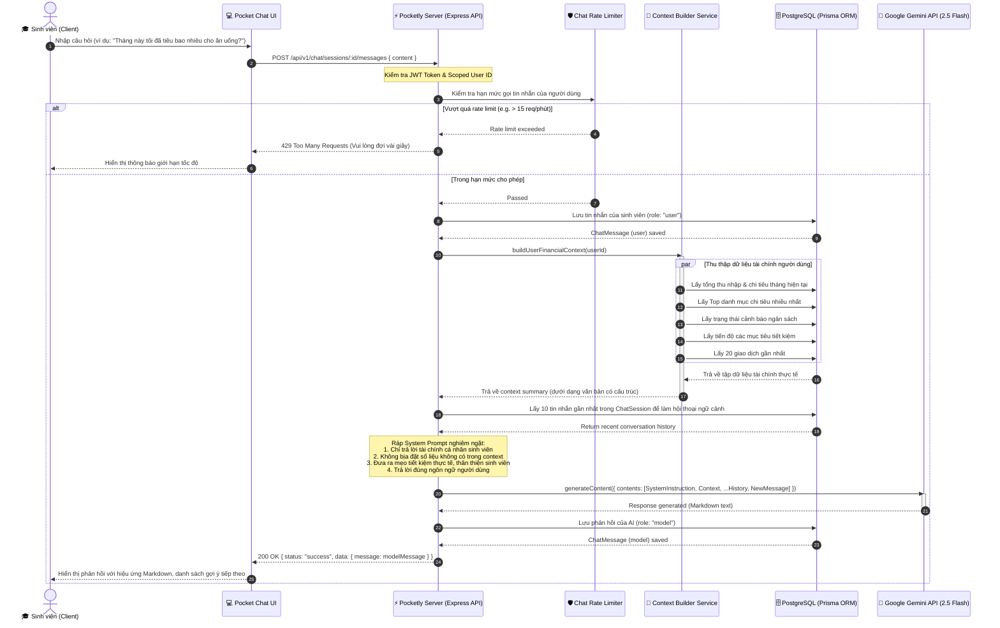

# Sơ đồ Tuần tự Luồng Chatbot AI (Chatbot Sequence Diagram)

Tài liệu này mô tả chi tiết luồng xử lý tương tác giữa Sinh viên, Giao diện Web, Backend Server, Cơ sở dữ liệu và Google Gemini API khi sinh viên gửi câu hỏi cho Trợ lý tài chính **Pocket Assistant**.

## Các Quy tắc Bảo vệ Ngữ cảnh & Hệ thống

1. **Bảo mật dữ liệu tuyệt đối (Data Isolation)**:
   - Dữ liệu tài chính sinh viên được truy vấn đúng theo `req.user.id` từ JWT đã xác thực. Không có rò rỉ dữ liệu giữa các sinh viên.
2. **Không ảo giác số liệu (Grounding / Anti-hallucination)**:
   - Hệ thống nghiêm cấm Gemini API tự suy đoán số dư hoặc số tiền ngoài các số liệu đã được `ContextBuilder` tổng hợp từ PostgreSQL.
3. **Phục hồi lỗi êm dịu (Graceful Degradation)**:
   - Khi Gemini API gặp sự cố mạng hoặc quá tải quota, hệ thống bắt lỗi và trả về phản hồi lịch sự, không làm treo ứng dụng client.
