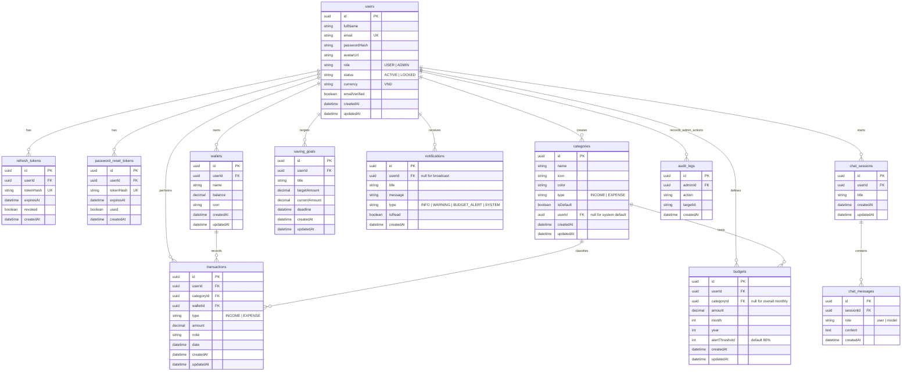

# Sơ đồ Thực thể Quan hệ (Entity-Relationship Diagram - ERD)

Tài liệu này mô tả cấu trúc cơ sở dữ liệu của hệ thống **Pocketly** được xây dựng trên **PostgreSQL** và quản lý thông qua **Prisma ORM**.

## Diễn giải Mối quan hệ
1. **User (Người dùng)**:
   - Là thực thể trung tâm, liên kết với hầu hết các dữ liệu tài chính (Ví, Giao dịch, Danh mục tùy chỉnh, Ngân sách, Mục tiêu, Phiên tư vấn AI).
   - Có cờ `role` (`USER` hoặc `ADMIN`) và `status` (`ACTIVE` hoặc `LOCKED`).
2. **Category (Danh mục)**:
   - Nếu `userId` là `null`, đây là **Danh mục Mặc định của Hệ thống** (do Admin quản lý).
   - Nếu `userId` có giá trị, đây là **Danh mục Tùy chỉnh** do sinh viên tự tạo.
3. **Transaction (Giao dịch)**:
   - Thuộc về một người dùng, liên kết với một `Wallet` (để cộng/trừ số dư theo cơ chế transaction) và một `Category`.
4. **Budget (Ngân sách)**:
   - Hỗ trợ ngân sách theo từng danh mục hoặc ngân sách tổng toàn tháng (`categoryId` = null).
   - Có `alertThreshold` (mặc định 80%) để kích hoạt thông báo tự động khi sinh viên sắp vượt giới hạn.
5. **Notification (Thông báo)**:
   - Hỗ trợ cả thông báo cá nhân (`userId` cụ thể) và thông báo phát sóng toàn hệ thống (`userId` = null).
6. **ChatSession & ChatMessage**:
   - Lưu trữ lịch sử hội thoại tài chính với Google Gemini AI, giúp duy trì ngữ cảnh khi sinh viên đặt câu hỏi liên tiếp.
7. **AuditLog**:
   - Tự động ghi lại các hành động nhạy cảm của Admin (Khóa tài khoản, Thay đổi danh mục hệ thống, Phát sóng thông báo) phục vụ kiểm toán an ninh.
