# Sơ đồ Ca sử dụng (Use Case Diagram)

Tài liệu này mô tả các tác nhân (Actors) và các ca sử dụng (Use Cases) chính trong hệ thống **Pocketly**.

```mermaid
flowchart TD
    %% Actors
    Student(("🎓 Sinh viên / Người dùng (User)"))
    Admin(("🛡️ Quản trị viên (Admin)"))
    GeminiAI(("🤖 Google Gemini AI Engine"))

    subgraph AuthModule ["Xác thực & Hồ sơ"]
        UC_Register["Đăng ký tài khoản (Kiểm tra độ mạnh MK)"]
        UC_Login["Đăng nhập & Nhận Refresh Token (HttpOnly Cookie)"]
        UC_ForgotPass["Quên mật khẩu & Đặt lại qua Email Token"]
        UC_Profile["Cập nhật Hồ sơ & Tải Avatar"]
    end

    subgraph FinancialModule ["Quản lý Tài chính Sinh viên"]
        UC_Wallets["Quản lý Ví tiền & Chuyển tiền giữa các ví"]
        UC_Categories["Quản lý Danh mục Chi tiêu / Thu nhập"]
        UC_Transactions["Quản lý Thu/Chi (Lọc, Tìm kiếm, Xóa hàng loạt)"]
        UC_Export["Xuất dữ liệu Giao dịch sang Excel / CSV"]
        UC_Budgets["Thiết lập Ngân sách tháng & Nhận cảnh báo chi tiêu"]
        UC_SavingGoals["Thiết lập Mục tiêu Tiết kiệm & Tích lũy"]
        UC_Reports["Xem Báo cáo Thống kê & So sánh MoM"]
    end

    subgraph ChatbotModule ["Trợ lý Tài chính AI (Pocket Assistant)"]
        UC_ChatSessions["Tạo & Quản lý Phiên hội thoại"]
        UC_AskAI["Trò chuyện & Nhận tư vấn chi tiêu thông minh"]
        UC_ContextFeed["Tổng hợp ngữ cảnh tài chính thực tế của sinh viên"]
    end

    subgraph AdminModule ["Cổng Quản trị Hệ thống (Admin Portal)"]
        UC_AdminStats["Xem Thống kê Dashboard & Phân bổ Người dùng"]
        UC_UserManage["Quản lý Người dùng (Khóa/Mở khóa, Đổi quyền, Xóa)"]
        UC_DefaultCat["Quản trị Danh mục Mặc định Hệ thống"]
        UC_ChatLogs["Xem Nhật ký Tương tác Chatbot & Tần suất sử dụng"]
        UC_AuditLogs["Truy vết Nhật ký Thao tác (Audit Logs)"]
        UC_Broadcast["Phát sóng Thông báo Hệ thống tới toàn bộ Sinh viên"]
    end

    %% Student connections
    Student --> UC_Register
    Student --> UC_Login
    Student --> UC_ForgotPass
    Student --> UC_Profile
    Student --> UC_Wallets
    Student --> UC_Categories
    Student --> UC_Transactions
    Student --> UC_Export
    Student --> UC_Budgets
    Student --> UC_SavingGoals
    Student --> UC_Reports
    Student --> UC_ChatSessions
    Student --> UC_AskAI

    %% Admin connections
    Admin --> UC_Login
    Admin --> UC_AdminStats
    Admin --> UC_UserManage
    Admin --> UC_DefaultCat
    Admin --> UC_ChatLogs
    Admin --> UC_AuditLogs
    Admin --> UC_Broadcast

    %% AI Engine connections
    UC_AskAI -.-> UC_ContextFeed
    UC_ContextFeed -.-> GeminiAI
    GeminiAI -.-> UC_AskAI
```

## Bảng Đặc tả Các Tác nhân (Actors)

| Tác nhân | Phân quyền | Mô tả chức năng chính |
| :--- | :--- | :--- |
| **Sinh viên (User)** | `USER` | Quản lý sổ thu chi cá nhân, phân bổ ngân sách học tập và sinh hoạt, lập kế hoạch tiết kiệm, tham khảo lời khuyên tài chính từ AI Chatbot. |
| **Quản trị viên (Admin)** | `ADMIN` | Quản trị tài khoản người dùng, giám sát an toàn hệ thống, cấu hình danh mục chi tiêu chuẩn, phân tích tương tác AI, phát thông báo khẩn cấp. |
| **Hệ thống AI (Gemini AI)** | External Service | Mô hình Gemini 2.5 Flash xử lý ngôn ngữ tự nhiên, phân tích hành vi tiêu dùng và sinh phản hồi tài chính có căn cứ. |
